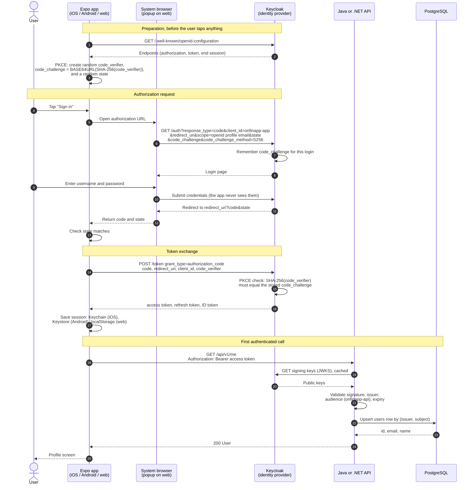

# Login flow (OIDC authorization code + PKCE)

How a user signs in to OnFinApp and makes the first authenticated API call. The same flow runs on iOS, Android
and web, against either API. Rendered copies: [login-flow.png](login-flow.png), [login-flow.svg](login-flow.svg).

## Why PKCE

The app is a public client: it cannot keep a client secret. PKCE replaces the secret with a one-time proof.
The app sends only the hash (`code_challenge`) in step 6 and reveals the original (`code_verifier`) in step 14,
over a direct connection to Keycloak. Anyone who intercepts the authorization code in steps 11-12 cannot
exchange it, because they do not have the verifier.

## Where this lives in the code

- App: `app/ui/react-native/src/auth/AuthContext.tsx` (steps 1-17), `src/api/client.ts` (step 18)
- Java API: `app/api/java/src/main/java/com/example/api/auth/SecurityConfig.java`, `user/UserController.java`
- .NET API: `app/api/dotnet/Program.cs`
- Keycloak realm: `deployment/local/keycloak/onfinapp-realm.json`

The diagram source is the Mermaid block above. After editing it, re-render the PNG and SVG.
